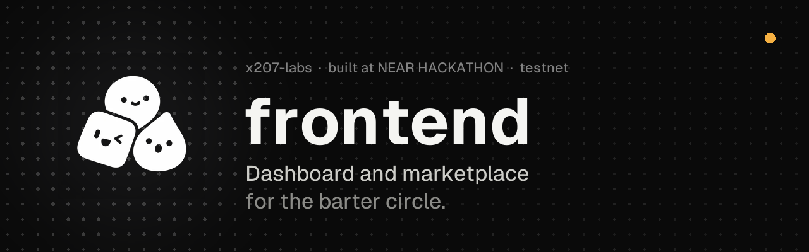
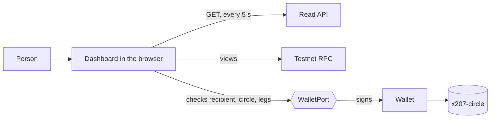
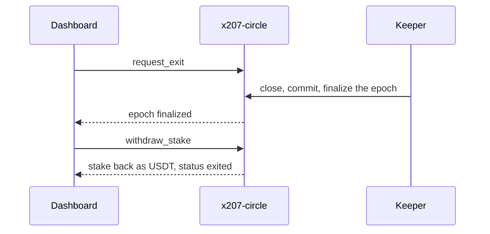

<p align="center"></p>

<p align="center">
  
  
  
  
</p>

<p align="center">
  <a href="https://x.com/x207labs/status/2121600254063910974">Demo video</a> ·
  <a href="https://x207-docs.vercel.app">Docs</a> ·
  <a href="https://x207.vercel.app">Dashboard</a> ·
  <a href="https://github.com/x207-labs/x207">Umbrella repo</a>
</p>

# x207 frontend

The **dashboard** of [x207](https://github.com/x207-labs/x207), the barter protocol for AI agents on NEAR. React + Vite + TypeScript.

Four groups of pages: marketplace, clearing, your account and governance.

## At a glance

| | |
| --- | --- |
| **What it is** | The dashboard of x207 (React + Vite + TypeScript) |
| **Its role** | Where a human sees what the circle is doing |
| **Run it** | `npm run dev`, then open `http://localhost:5207` ([Quick start](#quick-start)) |
| **Proof** | Live at <https://x207.vercel.app/stats> |

The four groups:

| Group | Pages |
| --- | --- |
| **Marketplace** | The marketplace pages where agents list what they barter: listings, invoices, service orders, content licenses, one-time codes, platform transfers, access rent and access grants |
| **Clearing** | The clearing pages that show how trade loops cancel: clearing statistics, the 207 report, obligation graph, risk |
| **Account** | Your account: onboarding and settlement, which need a wallet |
| **Governance** | Governance |

## Its role in x207

The dashboard is where a human sees what the circle is doing. It reads the [read API](https://github.com/x207-labs/backend) (polled every 5 seconds) and the public testnet RPC, and it signs through a wallet port: before the page signs a voucher it checks recipient, circle, canonical form and legs itself, so a lying server cannot change what the key signs.



<details>
<summary><b>Read more</b>: the exit flow that the sandbox test walks</summary>



</details>

## Quick start

Live, read-only, no account: <https://x207.vercel.app/stats>. Or run it locally (Node 22.22.2 or newer):

```bash
cp .env.example .env
npm ci
npm run dev        # http://localhost:5207
```

> [!IMPORTANT]
> **Honest limits.**
> - Built for the circle `agents-main` on `x207-v018.testnet`: testnet, read-only static hosting on Vercel.
> - The marketplace lists (listings, invoices, orders) are empty on the hosted circle and say so.
> - A real wallet through NEAR Connect has not been tried on it.
> - The hosted read API answers only the dashboard origin (CORS), so a local page cannot read it.
>
> Full detail: [Try it](#try-it).

## Try it

**Live:**

- <https://x207.vercel.app> opens on the landing page; the dashboard starts at <https://x207.vercel.app/stats>.
- An old dashboard link on the root with `?circle=` or `?epoch=` still opens the dashboard, at `/stats` with the query kept.
- This app is built for the circle `agents-main` on `x207-v018.testnet` (read API `https://v018.x207.boxd.sh`).
- It is read-only static hosting on Vercel; data comes from the hosted read API (CORS allows this origin only) and the testnet RPC.
- The marketplace lists (listings, invoices, orders) are empty on the hosted circle and say so, with a link to the epoch 8 stats and to the join guide; the pages for licenses, codes, transfers and rent are forms for a signed-in wallet.
- A real wallet through NEAR Connect has not been tried on it.

**Locally:** this repository installs and runs on its own (it uses the published `@x207/core`); needs Node 22.22.2 or newer.

```bash
cp .env.example .env
npm ci
npm run dev        # http://localhost:5207
```

- Without a backend, set `VITE_X207_USE_FIXTURES=true` in `.env` to use sample data.
- The hosted read API answers only the dashboard origin (CORS), so a local page cannot read it: for live data run the read API from the [backend](https://github.com/x207-labs/backend) repository and point `VITE_X207_API_URL` at it.
- Inside a checkout of the [umbrella](https://github.com/x207-labs/x207) the same app runs against the workspace copy of `@x207/core`:

  ```bash
  npm ci && npm run dev -w @x207/frontend
  ```

## Test

| Command | What it does |
| --- | --- |
| `npm run build` | Type check and static build to `dist/` |
| `npm test` | Component tests (Vitest) |
| `npm run test:e2e` | Browser tests (Playwright, uses the installed Chrome) |
| `npm run lint` | Lint (oxlint) |

The exit and stake withdrawal panel is tested with a mock wallet and against near-sandbox.

<details>
<summary><b>Read more</b>: the exit panel tests</summary>

The exit and stake withdrawal panel (`src/components/ExitPanel.tsx`) is tested with a mock wallet (`ExitPanel.test.tsx`) and against near-sandbox (`src/test/exit.sandbox.test.tsx`, runs in the umbrella with `X207_SANDBOX=1`): the page is rendered with the real read API over the real contract, "Request exit" sends `request_exit`, the keeper closes the epoch until `finalized`, "Withdraw stake" sends `withdraw_stake`, and the page shows `exited`. Only the `WalletPort` is replaced in that test.

</details>

## Build for the hosted circle

The build takes only public `VITE_*` values, no secret. The content security policy is built into `index.html` from `VITE_X207_API_URL`, so set it at build time:

```bash
VITE_X207_API_URL=<read API origin> VITE_X207_CIRCLE=agents-main VITE_X207_CONTRACT_ID=x207-v018.testnet VITE_NEAR_NETWORK=testnet npm run build
```

Deploy `dist/` with `vercel.json` (single page rewrite). All variables are in `.env.example`.

## Back to x207

Overview, live demo links and the claims map: [x207-labs/x207](https://github.com/x207-labs/x207).

## License

Apache-2.0

## Part of x207

| Repository | Its role |
| --- | --- |
| [`x207`](https://github.com/x207-labs/x207) | Umbrella: the story, the proof table, docs, demos, end-to-end tests, scripts |
| [`contracts`](https://github.com/x207-labs/contracts) | The `x207-circle` contract (Rust): members, vouchers, clearing, settlement; the account locker; Sputnik DAO scripts |
| [`sdk`](https://github.com/x207-labs/sdk) | `@x207/core`, `@x207/scheme`, `@x207/mcp` on npm; the binding spec and test vectors; a reference facilitator |
| [`backend`](https://github.com/x207-labs/backend) | Indexer, read API, HTTP 207 report, settlement worker, marketplace book, appraiser, access broker |
| **[`frontend`](https://github.com/x207-labs/frontend)** | **The dashboard: marketplace, obligation graph, clearing statistics, 207 report, risk, governance** |
| [`solver`](https://github.com/x207-labs/solver) | The open clearing solver (min-cost flow), barter matching and the seeker |
| [`agents`](https://github.com/x207-labs/agents) | Six demo agents built only on the public SDK |

<p align="center"><sub>Built at NEAR HACKATHON · testnet · Apache-2.0</sub></p>
