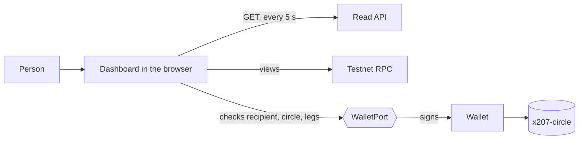
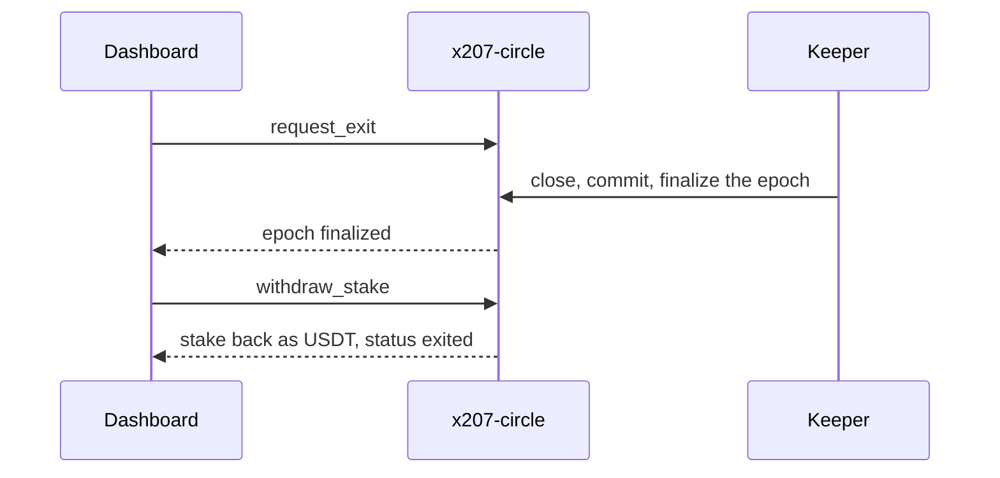

# x207 frontend

The dashboard of [x207](https://github.com/x207-labs/x207), in four groups: the clearing pages (clearing statistics, the 207 report, obligation graph, risk), your account (onboarding and settlement, which need a wallet), the marketplace pages (listings, invoices, service orders, content licenses, one-time codes, platform transfers, access rent and access grants) and governance. React + Vite + TypeScript.

## Its role in x207

The dashboard is where a human sees what the circle is doing. It reads the [read API](https://github.com/x207-labs/backend) (polled every 5 seconds) and the public testnet RPC, and it signs through a wallet port: before the page signs a voucher it checks recipient, circle, canonical form and legs itself, so a lying server cannot change what the key signs.



The exit flow that the sandbox test walks:



## Try it

**Live:** <https://x207.vercel.app> opens on the landing page; the dashboard starts at <https://x207.vercel.app/stats>. An old dashboard link on the root with `?circle=` or `?epoch=` still opens the dashboard, at `/stats` with the query kept. This app is built for the circle `agents-main` on `x207-v013.testnet`. It is read-only static hosting on Vercel; data comes from the hosted read API (CORS allows this origin only) and the testnet RPC. The marketplace lists (listings, invoices, orders) are empty on the hosted circle and say so, with a link to the epoch 8 stats and to the join guide; the pages for licenses, codes, transfers and rent are forms for a signed-in wallet. A real wallet through NEAR Connect has not been tried on it.

**Locally:** this repository installs and runs on its own (it uses the published `@x207/core`); needs Node 22.22.2 or newer.

```bash
cp .env.example .env
npm ci
npm run dev        # http://localhost:5207
```

Without a backend, set `VITE_X207_USE_FIXTURES=true` in `.env` to use sample data. The hosted read API answers only the dashboard origin (CORS), so a local page cannot read it: for live data run the read API from the [backend](https://github.com/x207-labs/backend) repository and point `VITE_X207_API_URL` at it. Inside a checkout of the [umbrella](https://github.com/x207-labs/x207) the same app runs against the workspace copy of `@x207/core`: `npm ci && npm run dev -w @x207/frontend`.

## Test

| Command | What it does |
| --- | --- |
| `npm run build` | Type check and static build to `dist/` |
| `npm test` | Component tests (Vitest) |
| `npm run test:e2e` | Browser tests (Playwright, uses the installed Chrome) |
| `npm run lint` | Lint (oxlint) |

The exit and stake withdrawal panel (`src/components/ExitPanel.tsx`) is tested with a mock wallet (`ExitPanel.test.tsx`) and against near-sandbox (`src/test/exit.sandbox.test.tsx`, runs in the umbrella with `X207_SANDBOX=1`): the page is rendered with the real read API over the real contract, "Request exit" sends `request_exit`, the keeper closes the epoch until `finalized`, "Withdraw stake" sends `withdraw_stake`, and the page shows `exited`. Only the `WalletPort` is replaced in that test.

## Build for the hosted circle

The build takes only public `VITE_*` values, no secret. The content security policy is built into `index.html` from `VITE_X207_API_URL`, so set it at build time:

```bash
VITE_X207_API_URL=<read API origin> VITE_X207_CIRCLE=agents-main VITE_X207_CONTRACT_ID=x207-v013.testnet VITE_NEAR_NETWORK=testnet npm run build
```

Deploy `dist/` with `vercel.json` (single page rewrite). All variables are in `.env.example`.

## Back to x207

Overview, live demo links and the claims map: [x207-labs/x207](https://github.com/x207-labs/x207).

## License

Apache-2.0
